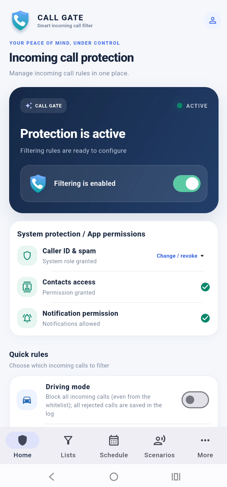
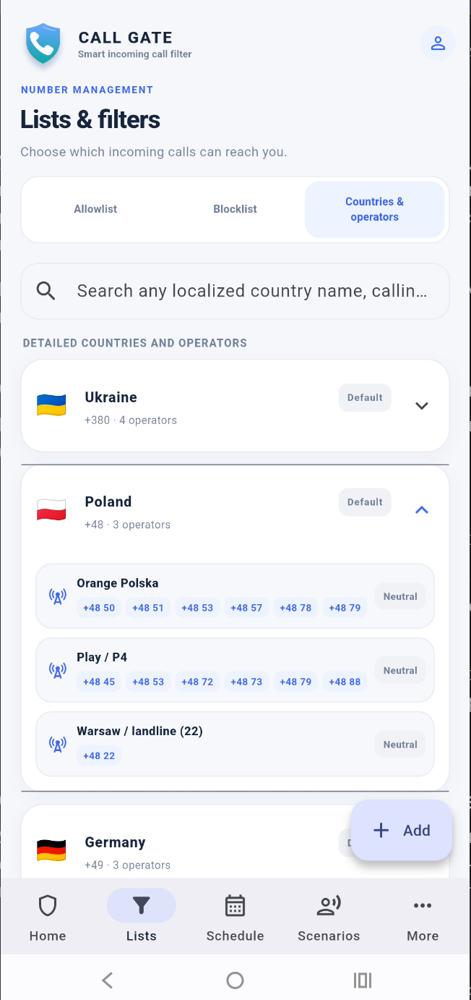
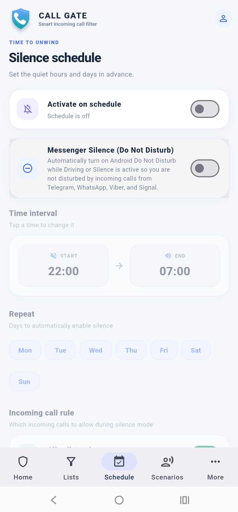
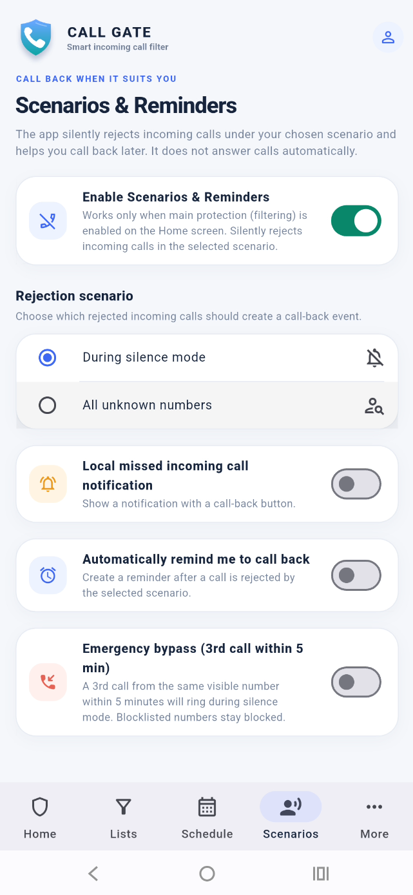
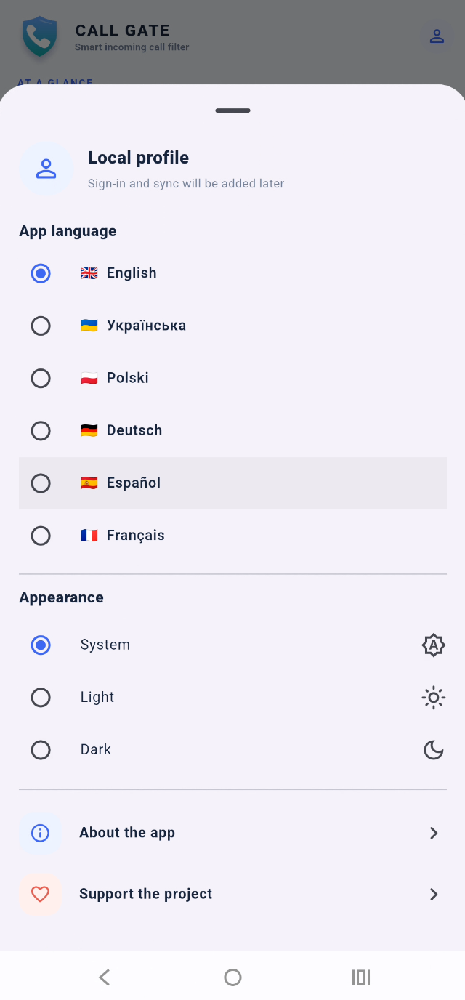

# CallGate v2.6.1

**CallGate** is an offline call manager for Android. Screen incoming calls, set quiet hours, and choose who can reach you—with no ads, subscriptions, accounts, or internet permission in the app manifest.

[](https://github.com/CyberDesignTech/call-guard/releases/latest)
[](LICENSE)

- **Website:** [cyberdesigntech.link](https://www.cyberdesigntech.link)
- **Privacy policy:** [CallGate Privacy Policy](https://www.cyberdesigntech.link/privacy.html)
- **Download:** [Latest GitHub release](https://github.com/CyberDesignTech/call-guard/releases/latest) · [CallGate-2.6.1.apk](release/CallGate-2.6.1.apk)

## Features

- **Allow and block lists** for contacts, groups, number patterns, and SIM selection.
- **Quiet hours** with a schedule, plus a manual **Driving** mode.
- **Urgent repeat-call bypass:** callers can get through after three repeat calls within five minutes.
- **Adaptive 4×1 home-screen widget** with quick mode switches.
- **Private by design:** app data stays on the device in a local SQLite database; no ads, subscriptions, tracking, or account required.
- **Six interface languages:** Ukrainian, English, Polish, German, Spanish, and French.

## Screenshots

| Home | Lists | Quiet hours |
|:---:|:---:|:---:|
|  |  |  |

| Scenarios | Settings |
|:---:|:---:|
|  |  |

## Privacy

Call screening and rule evaluation happen on your device. CallGate stores its settings, lists, and call history locally in SQLite and does not send them to a server. The Android app manifest and release APK do not request `android.permission.INTERNET`; downloading the app or visiting the website is handled by your browser.

Android permissions such as contacts, call log, and Do Not Disturb access are optional and are used only for the features that need them. See the [Privacy Policy](https://www.cyberdesigntech.link/privacy.html) for details.

## Build from source

### Requirements

- Flutter SDK
- Android SDK
- JDK 17

Clone the repository, then run:

```sh
flutter pub get
flutter analyze
flutter test
flutter build apk
```

For questions, bug reports, or feature requests, use [GitHub Issues](https://github.com/CyberDesignTech/call-guard/issues).

## License

CallGate is distributed under the [MIT License](LICENSE).
